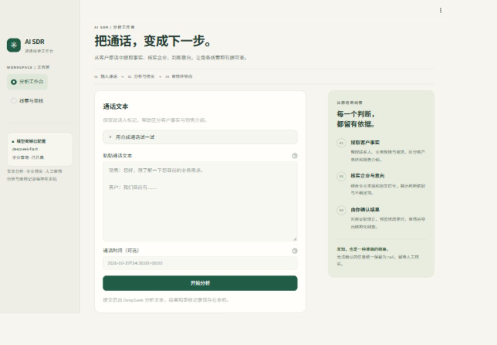

# AI SDR Agent

将销售通话文本转换为有原文依据的销售线索：提取客户事实，核实企业主体，评估购买意向，再由人工修正、审核并导出 JSON。这里的 SQL 指 Sales Qualified Lead（销售合格线索）。

- **分析工作台**：粘贴文本或载入明确标记的合成示例，查看企业候选、来源、意向信号、质量分和复核原因。
- **线索与审核**：按意向、审核状态和时间筛选；单条编辑或批量修正企业名称、意向；先预览再确认；保存前后值、审核人和说明。
- **本地持久化**：SQLite 保存原文、机器结果、人工修正与版本；单条导出 JSON 对象，批量导出对象数组。

仅接受文本，不提供音频上传或语音转写，不连接真实 CRM，也不自动联系客户。按本地单用户场景设计，尚未提供登录或多人权限管理。

[架构与实现](docs/architecture.md) · [评测报告](docs/evaluation-report.md) · [评测数据说明](evaluation/README.md) · [最新功能验收](docs/functional-acceptance.md)

界面采用米白与墨绿配色，宽屏并排展示输入区与操作提示，窄屏自动排列；线索结果按客户信息、业务规模、需求和跟进行动分组。下图为新版界面。



## 快速启动：Windows / Python 3.11

以下为 Windows PowerShell 操作步骤，Windows 11 可按相同路径配置 Python 3.11。**实际验证宿主为 Windows 10 家庭中文版 22H2（build 19045）、CPython 3.11.7 x64、Streamlit 1.66.0**；未单独验证 Windows 11。使用 Python 3.11 复现；`requirements.txt` 固定全部运行依赖及构建工具，`requirements-dev.txt` 固定测试与静态检查工具。macOS/Linux 也尚未实测。

在 PowerShell 中进入项目根目录。先确认 `python --version` 为 3.11.x；本机验证使用 `python` 命令，无需依赖 Windows `py` 启动器或激活脚本。

```powershell
git clone --branch main https://github.com/cccniuniu-hue/AI-SDR-Agent.git
cd AI-SDR-Agent
python --version
python -m venv .venv
.\.venv\Scripts\python.exe -m pip install --upgrade pip==25.2
.\.venv\Scripts\python.exe -m pip install -r requirements.txt
.\.venv\Scripts\python.exe -m pip install --no-build-isolation -e .
.\.venv\Scripts\python.exe -m pip check
if (-not (Test-Path -LiteralPath .env)) { Copy-Item -LiteralPath .env.example -Destination .env }
```

用编辑器打开 `.env`，填入自己的 `DEEPSEEK_API_KEY`，然后启动：

```powershell
.\.venv\Scripts\python.exe -m streamlit run app.py
```

浏览器打开 [http://127.0.0.1:8501](http://127.0.0.1:8501)。按 `Ctrl+C` 停止。若 8501 被占用，可在启动命令末尾加 `--server.port 8502`。

未配置密钥时页面仍能启动，历史数据、人工审核和导出仍可使用；“开始分析”按钮禁用并显示配置提示。载入示例只填入文本，点击分析才会发起真实 API 请求。请始终从项目根目录运行，以读取该目录的 `.env`、示例和 Streamlit 配置。

`requirements.txt` 包含 `setuptools==80.9.0`、`wheel==0.45.1`；先安装依赖再执行 `--no-build-isolation -e .`，可避免系统旧版构建工具影响结果。`pyproject.toml` 的隔离构建也固定相同版本。锁文件适用于上述验证环境；视频录制工具不属于应用依赖。

若在 macOS/Linux 尝试运行，将创建环境命令改为 `python3.11 -m venv .venv`，并把其余命令中的 `.\.venv\Scripts\python.exe` 替换为 `./.venv/bin/python`；配置复制使用 `cp .env.example .env`，已有 `.env` 时不要覆盖。此路径未做安装或运行验收。

## 配置与模型服务

| `.env` 字段 | 默认值 | 作用 |
| --- | --- | --- |
| `DEEPSEEK_API_KEY` | 空 | DeepSeek 密钥；仅真实分析、live 评测需要 |
| `DEEPSEEK_BASE_URL` | `https://api.deepseek.com` | 服务根地址 |
| `DEEPSEEK_MODEL` | `deepseek-flash` | 抽取和企业核实使用的模型 |
| `DEEPSEEK_THINKING` | `disabled` | 请求中的 thinking 模式 |
| `COMPANY_SEARCH_ENABLED` | `true` | 是否执行企业搜索与核实；设为 `false` 时保留待人工核实状态 |
| `DATABASE_PATH` | `.data/sdr.sqlite3` | 本地数据库路径；相对路径以启动目录为准 |

系统环境变量优先于 `.env`。修改配置后重启应用。密钥不会显示在页面或写入导出；`.env`、本地数据库和 `.data/` 已被 Git 忽略。

DeepSeek 客户端固定使用直连：聊天、Search 和 Fetch 请求都忽略 `HTTP_PROXY`、`HTTPS_PROXY`、`ALL_PROXY` 和系统代理设置，TLS 证书校验保持开启。若代理软件启用了 TUN/VPN 全局接管，仍需在该软件中为 `api.deepseek.com` 设置直连规则；应用级直连无法绕过系统网络隧道。更改 `DEEPSEEK_BASE_URL` 时，相应服务地址也需要能直连访问。

聊天使用 `/chat/completions` 的 JSON 输出；企业查询独立调用 DeepSeek Search `/v1/tools/search` 和 Fetch `/v1/tools/fetch`，不是普通聊天自动联网。实际模型及搜索能力取决于账户和服务配置，实测情况见[评测报告](docs/evaluation-report.md)。搜索失败、证据不足或多主体歧义时不猜公司名，保留 `null` 和复核原因。请求设有超时、有限重试与总时限，彻底失败的分析不会生成可编辑、可导出的正常线索。

点击分析会将通话文本发送给已配置的 DeepSeek 服务；查询企业时会发送相应检索信息。原文及结果保存在本机 SQLite 中。该程序是本地工具，默认仅监听 `127.0.0.1`。

## 使用与人工审核

1. 在“分析工作台”粘贴 1–20,000 字符文本，建议保留“销售：”“客户：”标记；通话日期通过日历选择（顶部年份在左、月份在右），小时和分钟通过独立下拉框点选，按北京时间（UTC+8）保存。时分初始显示 `00:00`，提交前请核对；未知时间应保持日期为空，点击日期框内的 × 可清空通话时间。
2. 点击“开始分析”，查看结果、证据与来源。普通页面重绘不会再次调用模型；再次显式提交会创建新的独立分析记录。
3. 在“人工修正”填写需修改的业务字段、审核人和说明，点击预览，再确认保存。通话时间同样支持选择和清空；已有时间换算为北京时间展示，未修改时保留原始精度和时区。空白字段保存为 `null`，机器质量分不可手动改写。
4. 标记已审核须确认核查过原文和证据；企业或意向仍未知时还须明确接受未知值。仅保存修改会保留待审核状态。机器未触发强制复核不等于人工已经审核。
5. 批量操作按稳定记录编号关联，先逐条展示差异再整批提交；发生版本冲突会回滚整批修改。导出使用当前已保存版本，预览中的修改不会提前写入导出。

审核完成后，可用独立表单将简称与主体关系加入别名库；须填写地区、行业、来源、关系依据和审核人。该映射只在后续分析中按相同地区和行业匹配，不会直接覆盖其他历史线索。

## 15 字段数据契约

每条业务 JSON 严格保留以下 15 个字段。未知值使用 JSON `null`，不以空字符串、`"未知"` 或猜测内容代替。内部证据、候选和审核元数据不混入业务导出。

| 字段 | 含义 | 类型 / 约束 |
| --- | --- | --- |
| `company_name` | 经核实的企业主体 | 字符串或 `null` |
| `industry` | 行业 | 字符串或 `null` |
| `area` | 地区 | 字符串或 `null` |
| `contact_name` | 联系人或原始称呼 | 字符串或 `null`；不扩写“张总”姓名 |
| `contact_title` | 已确认职位 | 字符串或 `null` |
| `phone` | 原文联系电话 | 字符串或 `null`；保留脱敏形式 |
| `intent_level` | 购买意向 | `high` / `medium` / `low` / `null` |
| `intent_reason` | 意向依据 | 字符串或 `null` |
| `demand_summary` | 客户需求摘要 | 字符串或 `null` |
| `mendian` | 门店数 | 非负整数或 `null` |
| `shejishi` | 设计师人数 | 非负整数或 `null` |
| `call_time` | 通话时间 | 带时区的 ISO 8601 字符串或 `null` |
| `next_action` | 系统建议的下一步 | 字符串或 `null` |
| `confidence_score` | 证据质量指标 | 0–1 数值或 `null`，不是购买概率 |
| `need_human_review` | 是否仍需人工审核 | 布尔值；正常线索始终有值 |

缺失人数不等于 0；近似人数不能当精确人数；未提预算不等于没有预算；信息不足的意向不强行归为 `low`。通话时间不使用处理时间代替。

## 模块与工作流

```text
通话文本 → 原文编号 / 输入校验 → DeepSeek 信息抽取 → 引文与字段校验
                                                 ├→ 企业候选 / Search / Fetch / 主体核实
                                                 └→ 规则意向评分 / 证据充分度
                                  质量评估 → SQLite 保存 → 人工审核 → JSON 导出
```

| 模块 | 职责 |
| --- | --- |
| [`app.py`](app.py)、[`ui.py`](src/sdr_agent/ui.py) | Streamlit 两页界面、预览与确认 |
| [`workflow.py`](src/sdr_agent/workflow.py) | 显式工作流、阶段进度、失败落盘 |
| [`deepseek.py`](src/sdr_agent/deepseek.py)、[`prompts/`](src/sdr_agent/prompts/) | API、JSON 校验与修复、抽取和主体核实 Prompt |
| [`extraction.py`](src/sdr_agent/extraction.py)、[`schemas.py`](src/sdr_agent/schemas.py) | 原文证据检查、严格类型与 `null` 契约 |
| [`company.py`](src/sdr_agent/company.py) | 候选评分、别名范围、主体关系与歧义处理 |
| [`intent.py`](src/sdr_agent/intent.py)、[`quality.py`](src/sdr_agent/quality.py) | 意向区间、否定和冲突、质量分及审核原因 |
| [`repository.py`](src/sdr_agent/repository.py)、[`review.py`](src/sdr_agent/review.py) | SQLite、版本检查、事务审核、历史与导出 |
| [`evaluation.py`](src/sdr_agent/evaluation.py) | 开发 / 保留集评测、直接 Prompt 基线、逐样本记录与恢复 |

企业证据、意向规则和审核机制见[架构与实现](docs/architecture.md)。

## 开发与提交

本项目默认直接在 `main` 分支提交并推送，不要求创建 PR/MR。推送前检查远端更新并完成相关验证，保留已有改动。实施计划、设计草案和准备记录仅保留在本地，不提交到 GitHub；仓库保留运行说明、实现说明与评测材料。

## 测试与评测

手工验收请使用[完整测试手册](docs/manual-testing/README.md)：包含89条操作用例、22段可复制通话样例、Excel执行记录表，以及隔离测试库和本地异常模拟方法。所有用例初始标为未执行，适合逐项验证后记录结果。

安装开发依赖后执行以下离线检查；测试使用临时数据库与服务替身，不需要真实密钥：

```powershell
.\.venv\Scripts\python.exe -m pip install -r requirements-dev.txt
.\.venv\Scripts\python.exe -m pytest -q
.\.venv\Scripts\python.exe -m ruff check .
.\.venv\Scripts\python.exe -m pip check
```

以下 fixture 命令只验证评测与落盘流程，使用固定空值替身，**不调用模型、不执行抽取或搜索，不代表模型效果**：

```powershell
.\.venv\Scripts\python.exe -m sdr_agent.evaluation --dataset evaluation/dev.jsonl --mode fixture --baseline --output .data/fixture-dev.json
```

配置有效密钥后，使用真实 API 对同一批样本分别运行完整工作流和直接 Prompt 基线：

```powershell
.\.venv\Scripts\python.exe -m sdr_agent.evaluation --dataset evaluation/dev.jsonl --mode live --baseline --output .data/live-dev.json
.\.venv\Scripts\python.exe -m sdr_agent.evaluation --dataset evaluation/holdout.jsonl --mode live --baseline --output .data/live-holdout.json
```

live 命令会产生模型与查询请求。每次评测使用新的输出名；中断后在原命令末尾添加 `--resume`，只有相同数据、模式、模型及代码指纹才能恢复。已有失败记录不会自动重试，应使用新输出路径重新评测。汇总 JSON 旁保存逐样本 `.samples.jsonl`；live 模式另外保存本次 `.sqlite3`，不会写入应用默认数据库。

开发集与保留集各 12 条，均为**合成对话**，情景组互不重叠；每组包含 high、medium、low、null 各 3 条。保留集企业标签全为未知，不能据此估计已知企业识别精度或覆盖率。合成数据、服务替身测试和少量真实 API 调用都不能替代真实业务数据评测；质量分也未经概率校准。指标、错误样本和可确认的限制以[评测报告](docs/evaluation-report.md)为准。

## 本地复现记录

2026-10-19 在 Windows 10 22H2（build 19045）/ Python 3.11.7 x64 主机中新建 `.data/repro-venv`，按上述顺序安装固定依赖和 editable 项目：

- 44 个运行 / 构建包与锁文件版本一致；`pip check` 无依赖冲突。
- 全部 `sdr_agent` 模块可导入；AppTest 无密钥工作台及历史页启动通过，分析按钮禁用，模型请求为 0。
- 安装开发锁后，121 项测试通过，Ruff 检查通过（含新增卡片与证据 HTML 转义检查）。
- fixture 开发集与直接 Prompt 替身共写入 24 / 24 条记录；该结果只验证评测管道，不代表模型效果。

该临时环境和验证数据库不提交仓库；它不复用开发 `.venv` 的 site-packages，也未安装视频录制工具。
