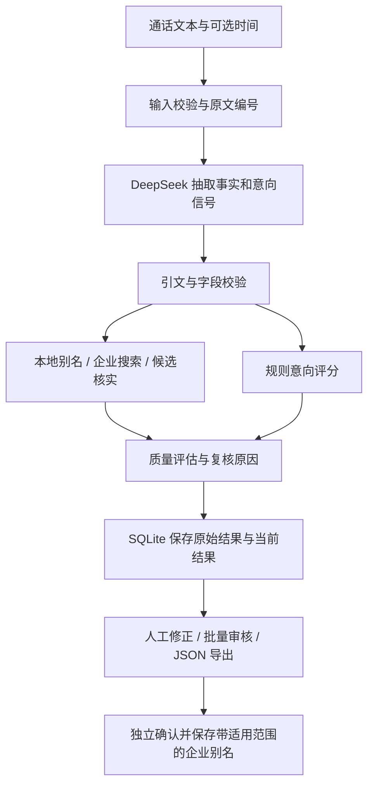

# AI SDR Agent 架构与实现

本文说明当前源码的实现。安装步骤、页面操作和完整的 15 字段契约见 [README](../README.md)，效果与限制见 [评测报告](evaluation-report.md)。

## 架构与数据流

应用由 Streamlit 界面、显式 Python 工作流、DeepSeek 服务适配和 SQLite 持久层组成。输入仅为文本，未知信息统一使用 `null`；不接入真实 CRM。

[`workflow.py`](../src/sdr_agent/workflow.py) 编排分析阶段；页面重绘不触发模型调用，每次显式分析创建独立记录。彻底失败的记录保留错误状态，不提供正常线索的编辑与导出。

## Prompt 与事实校验

- [抽取 Prompt](../src/sdr_agent/prompts/extraction.md) 要求结构化事实、客户意向信号以及 `turn_id + speaker + quote` 原文依据。未知、冲突和不能确定的近似数量保留为 `null`。
- [企业 Prompt](../src/sdr_agent/prompts/company.md) 仅允许引用已提供的来源，输出候选全称和主体关系原句；最终确认由程序执行。
- [`extraction.py`](../src/sdr_agent/extraction.py) 重新检查引用是否来自指定原文、说话人是否符合要求，以及事实字段与证据是否一致。销售介绍不能直接成为客户需求，称呼不能自动推断职位。
- 通话文本和网页内容均作为不可信资料，不能覆盖 Prompt 指令。输出通过 Pydantic 严格类型和字段校验；无效 JSON 的修复有次数限制。

## 企业主体核实

[`company.py`](../src/sdr_agent/company.py) 先检查带地区、行业和来源的已审核别名，必要时调用 Search / Fetch 获取候选正文。程序核验来源 URL、全称引文、主体关系、地区和行业；品牌总部、加盟门店和独立经营主体不会仅凭名称相似自动关联。

候选分由全称证据 0.30、主体关系 0.35、地区 0.20、行业 0.15 组成。自动确认还须满足必要证据条件，得分至少 0.85，并领先第二候选至少 0.15。歧义、证据不足或查询不可用时保留 `company_name=null`，供人工查看候选与原因。这些规则降低误报，但不等同于官方工商数据库核验。

## 意向与质量评估

模型抽取信号，[`intent.py`](../src/sdr_agent/intent.py) 执行固定规则。痛点、时间、预算、推进意愿和规模的权重依次为 30、25、20、20、5；每个信号取 0、0.5、1 或 `null`。

已知信号计算得分下界，未知信号的权重形成上下界区间；全部未知时区间也为 `null`。分类依次处理：

1. 角色或关键信号冲突：`null`，交由人工判断。
2. 有原文依据的当前明确拒绝：`low`。
3. 下界至少 70，痛点明确，时间或预算至少 0.5，推进意愿至少 0.5：`high`。
4. 已知权重至少 60，区间上界低于 40：`low`。
5. 至少两个维度有正向信号，且包含痛点或推进意愿：`medium`。
6. 其余：`null`。

[`quality.py`](../src/sdr_agent/quality.py) 计算 0.45 × 企业质量分 + 0.40 × 意向证据充分度 + 0.15 × 事实证据覆盖率，保留两位小数。总分始终为0.0–1.0的数值；未知分项按0贡献，权重不重新分配，分项本身保留 `null`。全部分项未知时总分为0.0。该规则版本为 `quality=2.0`，该分数不是购买概率。

企业或意向未知、依赖降级、证据问题、角色冲突、任一评分分项未知或总分低于 0.80 都会产生人工复核原因。即使总分不低于0.80，只要有未知分项，仍需复核。人工审核保留原始机器分数，不将确认行为伪装成模型分数提升。

## 审核、存储与反馈

[`repository.py`](../src/sdr_agent/repository.py) 保存通话、分析记录、修改事件和企业别名。首次机器结果与当前结果分别存储，审核状态为 `pending`、`edited` 或 `approved`。

[`review.py`](../src/sdr_agent/review.py) 按稳定记录 ID 与版本处理单条或批量修改。界面先展示固定预览快照，再确认保存；版本冲突拒绝旧修改，批量操作发生冲突时整批回滚。每次修改保存审核人、说明和前后值。

未知字段可保持 `null`，但标记已审核时须明确确认已核查并接受未知的企业或意向。别名反馈使用独立表单，须提供适用地区、行业、关系依据和来源，仅影响后续分析。

导出读取数据库中当前已保存版本，严格输出 15 个业务字段。候选、证据和审核元数据不混入业务 JSON。

## 运行边界与验证

应用默认仅监听 `127.0.0.1`，数据库与密钥不提交 Git。模型与查询请求有超时、有限重试和总时限；配置或认证失败显示可操作的提示，不展示原始敏感错误。

当前测试覆盖字段契约、事实和企业证据、意向规则、异常处理、持久化、审核事务、UI 预览和转义。合成数据、服务替身和少量真实 API 联调不构成真实业务准确率证明。评测集、基线、指标及已知局限详见 [评测说明](../evaluation/README.md) 和 [评测报告](evaluation-report.md)。
