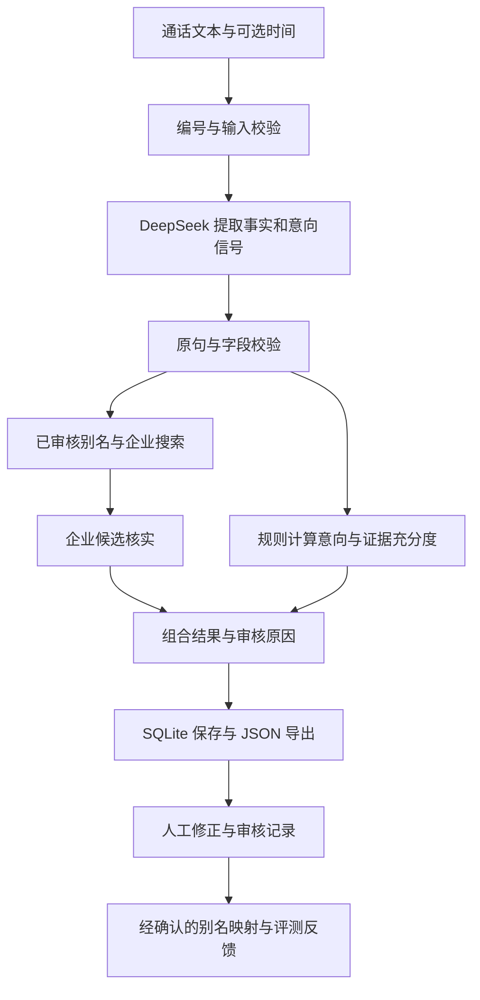

# AI SDR Agent 开发设计

日期：2026-10-19。状态：开发前方案，尚未实现、尚未完成真实 API 联调。

## 1. 目标与已确认边界

面向销售人员，将一段电话沟通文本转换为带有证据的结构化线索，并让人工快速审核企业名称和购买意向。

用户已确认：仅文本输入，不做音频上传或转写；不接真实 CRM；交付 GitHub 仓库及可复现的本地运行说明；未知或无法可靠确认的值统一为 JSON `null`；模型服务使用 DeepSeek。

第一版按本地单用户使用设计，包含文本分析、企业核实、意向判断、历史线索、单条审核、批量订正、JSON 导出、评测与说明文档。不加入登录权限、多租户、自动营销、CRM 同步或模型训练。

现有条件足以开始开发。真实联调前需要在本地配置有效的 `DEEPSEEK_API_KEY`；密钥不写入文档、源码或 Git。企业搜索的账号可用性需要联调确认，失败时必须显示查询状态并转人工审核。

## 2. 方案比较与选择

| 方案 | 优点 | 代价 | 结论 |
| --- | --- | --- | --- |
| Python + Streamlit + SQLite | 一个 Python 环境即可运行，便于实现表格审核，交付步骤短 | 自定义视觉效果和复杂多人交互空间较小 | 第一版采用 |
| FastAPI + React + SQLite | 前后端独立，界面定制空间大 | 增加接口、前端工具链及两个服务的联调 | 后续产品化时再考虑 |
| 单个 Prompt + JSON 展示 | 原型快 | 企业核实、证据检查、反馈和异常恢复不足 | 只作为离线对比基线 |

建议使用 Python 3.11、Streamlit、Pydantic 2、HTTPX、python-dotenv，以及标准库 sqlite3。测试使用 pytest；页面使用 Streamlit AppTest 加浏览器验收；格式与静态检查使用 Ruff。开发时解析并锁定实际通过验证的依赖版本。

采用显式的 Python 工作流。按需要调用抽取模型、搜索与企业核实工具，步骤和异常均可追踪；第一版不引入复杂 Agent 编排框架。

## 3. 外部服务依据

官方资料核实于 2026-10-19，具体账号能力以真实请求结果为准。

- DeepSeek 提供兼容 OpenAI 格式的聊天接口，当前文档推荐模型名 `deepseek-flash`，模型名保留为配置项。[接口说明](https://api-docs.deepseek.com/)
- JSON Output 使用 `response_format={"type":"json_object"}`；仍需处理空内容、截断及业务字段不符合约定的情况。[JSON Output](https://api-docs.deepseek.com/guides/json_mode/)
- Search 与 Fetch 为独立 HTTP API，使用同一 DeepSeek API Key；可请求搜索结果与网页正文。[Search & Fetch](https://api-docs.deepseek.com/guides/search/)
- 默认抽取使用非思考模式，企业候选核实也先使用相同模式；模型模式可配置，通过评测决定是否切换。[Thinking Mode](https://api-docs.deepseek.com/guides/thinking_mode/)
- Streamlit 提供可编辑表格；保存、审核及批量操作由应用事务控制。[data_editor](https://docs.streamlit.io/develop/api-reference/data/st.data_editor)
- Pydantic 用于约束输出结构，不代表业务内容自动正确。[Models](https://docs.pydantic.dev/latest/concepts/models/)

搜索和模型推理分别调用；不能假设模型在普通聊天请求中自动访问互联网。模型提供的公司名或 URL 不能直接作为已核实证据。

## 4. 页面与使用流程

### 分析工作台

输入：粘贴通话文本，可选填写已知通话时间和线索备注；提供若干合成示例文本。首版限制为 1–20,000 字符，超长提示拆分，不静默截断。

点击分析后展示抽取、企业核实、生成结果的进度。结果区展示企业主体与候选、意向等级、证据原句、评分明细、缺失项、需审核原因及 15 字段 JSON。允许复制或下载 JSON。

缺少 API Key 时页面仍能启动、查看已有记录，分析按钮给出配置指引；不会把固定样例伪装为实时分析结果。

### 线索与审核

列表支持按意向、审核状态和时间筛选。选择一条线索后，左侧为带编号的对话，右侧为企业候选、意向证据和可编辑字段。

修改与审核分开：保存修改保留待审核状态；点击“完成审核”须填写审核人和说明，并逐项确认关键歧义已处理或接受未知值。审核后允许企业名仍为 `null`，但说明必须明确“已检查，现有信息无法确认”。

批量订正支持对所选记录设置企业名称或意向等级、清空为 `null`、批量完成审核。先展示变更预览，再一次性提交；审核人、说明和每条记录原值均留痕。批量写入遇到版本冲突则整批回滚。

导出默认使用当前已保存版本。单条导出 JSON 对象，批量导出 JSON 对象数组；数组中的每个对象均严格包含原题 15 个字段。审核元数据在应用中展示，与业务 JSON 分开。

## 5. 工作流与证据

每次分析生成独立 `run_id`，记录输入摘要哈希、模型名、Prompt 版本、评分规则版本和耗时。相同文本可显式重新分析，生成新的 run，不覆盖已审核结果。Streamlit 组件重绘不得触发重复模型请求。

事实证据采用 `turn_id + quote + speaker`。引文必须能在指定原句中找到；校验引文不等于证明推断正确，还须检查说话人、否定和上下文。无法支持的字段置 `null` 并记录问题。

仅把客户表达或明确确认的内容作为客户事实。销售说“支持一键出图”不能自动变成客户要求；“设计部约 15 人”保留近似标记，不能据此断言恰好有 15 位设计师。

通话文本和检索内容均作为待分析材料；其中的“忽略规则”“全部设为高意向”等文字不能成为系统指令。只输出简短业务依据与引用，不展示模型内部思考过程。

## 6. 数据契约

业务导出固定保留原题 15 个字段，字段缺失也不能省略。系统内部额外保存证据、候选、评分和审核日志，不能混入业务导出。

| 字段 | 类型与约束 |
| --- | --- |
| company_name | string 或 null；仅在企业主体得到核实时填入 |
| industry、area | string 或 null；不依据想象补充地区或行业 |
| contact_name | string 或 null；允许保留“张总”这一原始称呼，不扩写真实姓名 |
| contact_title | string 或 null；“总”不等同于已确认总经理或老板 |
| phone | string 或 null；保留原始脱敏形式，不补齐号码 |
| intent_level | high、medium、low 或 null；未知不归为 low |
| intent_reason | string 或 null；说明已知依据、反向证据及关键未知项 |
| demand_summary | string 或 null；只总结客户真实表达的需求 |
| mendian、shejishi | 非负整数或 null；近似/区间且不能得出确定人数时为 null，内部保留原话 |
| call_time | 带时区的 ISO 8601 字符串或 null；来自输入元数据或可无歧义解析的原文 |
| next_action | string 或 null；为系统建议，与原文事实区分 |
| confidence_score | 0–1 数值或 null；规则计算的可靠程度指示，不宣称为校准概率 |
| need_human_review | 布尔值；由工作流和审核状态计算，正常结果始终有值 |

字符串输入去除前后空白后为空，则统一存为 null。人数为 0 必须有明确证据。用户明确输入的本地通话时间使用 Asia/Shanghai，处理时间另存为 created_at；“下个月”在没有通话日期时保留相对说法。

输出校验使用严格类型、禁止额外字段、保留所有 null。业务推断失败与运行失败分开：网络或解析彻底失败的 run 标记 failed，不制造一条貌似正常的全空线索。

## 7. 企业抬头还原

1. 提取客户原始称呼、地区、行业以及总部/分店/加盟商等关系线索。
2. 查询已人工审核的本地别名映射。映射带地区、行业和适用主体约束，不允许品牌名全局覆盖所有同名门店。
3. 必要时使用 DeepSeek Search 查询企业简称、地区及行业。每条线索最多两个查询，每次最多五条结果；查询只包含企业相关信息。
4. 如搜索正文不足，最多 Fetch 两个已有候选 URL；优先企业官网主体说明、公开登记信息，其次可核实的企业资料页面。
5. 将候选正文交给模型作证据限定的比较，再由程序检查候选来源、证据引文、上下文匹配和竞争候选。
6. 证据不足、同名冲突、只能确认品牌归属或加盟主体不明时，company_name=null，展示最多三个候选并进入审核。

自动通过条件：证据直接支持完整企业名称及客户称呼与该主体的关系；行业与已知地域不冲突；无同等证据的竞争候选。不得仅凭搜索排序、相似度高或模型声称“确定”而通过。

内部企业质量分初始规则：正文明确全称 0.30、直接支持主体关系 0.35、地域一致 0.20、行业一致 0.15；无法核实的项不加分。自动通过除满足必要条件外，还须至少 0.85，且比第二候选高至少 0.15。阈值是初始业务规则，需记录版本并在开发集上调整。

人工修正不会自动污染别名库。审核人单独选择“保存适用范围内的别名映射”并填写来源或核实说明后，才供后续查询使用；该映射本身保留审核来源。

搜索不可用时可继续完成信息抽取和意向判断，但未核实的企业名称保持 null。网页查询不等同于具备官方企业库的权威校验能力。

## 8. 客户意向评分

模型负责抽取可验证信号，程序执行显式规则。初始评分卡如下，每项为 0、0.5、1 或 null。

| 维度 | 权重 | 0 / 0.5 / 1 的语义 |
| --- | ---: | --- |
| 实际痛点 | 30 | 明确无需求 / 泛化改善意愿 / 明确当前问题与影响 |
| 时间安排 | 25 | 明确无采购计划或一年后 / 有计划但时间宽泛 / 三个月内有试用或采购安排 |
| 预算条件 | 20 | 明确当前无预算 / 有预算意愿但待落实 / 明确可接受预算或已批准 |
| 主动行动 | 20 | 明确拒绝推进 / 泛泛了解或接受资料 / 主动要求报价、试用或约定演示 |
| 使用规模 | 5 | 明确无使用者 / 已知 1–4 位 / 已知至少 5 位实际使用者 |

未提及、语义不明或互相冲突时为 null，内部同时记录状态 unknown/conflict 与依据。数量本身不证明意向高。

令已知项的加权得分为 L，未知项的权重和为 M，则可能得分区间为 [L, L+M]。这里 L 是保守下界，并不表示把未知项赋为 0；若五项全部未知，score_lower 和 score_upper 均为 null，显示“证据不足”，不显示 0 分。

分类按以下顺序执行：

1. 无法解释的关键冲突，或销售/客户角色无法辨认：null，转人工。
2. 客户明确表达当前不需要或拒绝采购推进，且无后续明确反转：low。单纯“现在不方便通话”不属于拒绝采购。
3. L≥70，实际痛点为 1，时间或预算至少一项≥0.5，主动行动≥0.5：high。
4. 已知权重至少 60，且上界 L+M<40：low。
5. 至少两个不同维度有正向信号，且包含痛点或主动行动：medium。
6. 其余：null，保留不确定性并要求审核。

当存在明确“之前不需要，但现在准备采购”等转折时，采用有证据支持的最新立场；无法判断哪一个有效则记录冲突。

意向证据充分度规则：明确且无冲突的拒绝为 0.90；其余由已知权重比例计算，并在角色或信号冲突时设为 null。低意向可以有高证据充分度。

综合 confidence_score 在企业分、意向证据充分度、事实证据覆盖率均有定义时，取 0.45×企业分 + 0.40×意向充分度 + 0.15×事实覆盖率，保留两位小数；任何部分无法计算则为 null。页面同时显示各部分，避免一个总分掩盖企业歧义。

事实证据覆盖率的分母为抽取阶段尝试填入的非空事实字段数，分子为证据检查通过的数量；检查范围为 industry、area、contact_name、contact_title、phone、mendian、shejishi、call_time。用户明确填写的通话时间按可信输入计入。分母为零时覆盖率为 null；被证据检查清空的字段仍计入分母。它衡量填值依据，不衡量客户资料完整度。

need_human_review 在公司名/意向未知、候选歧义、证据冲突、依赖降级、总分未知或低于 0.80 时为 true。非关键字段缺失单独列出，不一律强制审核。审核完成后设为 false，保留原始机器结果与其历史分数，不把人工确认伪装成模型分数提升。

## 9. 持久化与反馈

SQLite 文件默认位于 `.data/sdr.sqlite3`，不提交 Git。

| 表 | 主要内容 |
| --- | --- |
| calls | id、原始文本、可选通话时间、创建时间、内容摘要哈希 |
| analysis_runs | id、call_id、运行状态、机器原始 JSON、当前 JSON、证据与候选、评分明细、审核状态、version、模型及规则版本、耗时、错误码 |
| review_events | run_id、修改前后值、审核人、说明、动作、前后版本、时间 |
| company_aliases | 原始别名、已确认主体、适用地区/行业/关系、证据与审核来源、创建时间 |

审核状态为 pending、edited、approved；运行状态为 running、succeeded、partial、failed。failed 不是待审核线索，需重新分析；partial 表示企业查询等步骤降级但已有可用结果。

每次写入采用事务和 version 检查；原始机器结果不可覆盖。批量操作按 run_id 匹配，不能依据可变的表格行号修改数据。JSON 导出从持久层读取当前快照，保证重启后一致。

## 10. 错误处理与运行约束

- HTTP 401/403、余额不足或无效模型：不盲目重试，显示可操作的配置提示。
- 超时、429、5xx：每个请求最多重试两次，退避 1 秒、2 秒；单次请求超时 30 秒，整条分析最多 180 秒。
- 空响应、JSON 截断或字段校验失败：只允许一次修复请求；仍失败则标记 failed，并保留脱敏错误摘要。
- 首次信息抽取失败则不继续企业搜索；搜索失败则保留抽取及意向结果并标记 partial。
- 正常分析最多两次模型调用：事实/信号抽取，以及必要时的企业候选核实；JSON 修复和网络重试另行记录，并受全局时限约束。
- .env、数据库、真实通话及包含个人信息的运行日志均不入库；日志只记录运行 ID、阶段、耗时和脱敏错误。
- 本地监听 127.0.0.1；不自动把应用发布到公网。

## 11. 评测与验收

先建立 24 条清楚标为合成数据的文本案例，高/中/低/未知各 6 条；开发集与保留集各 12 条，每类各 3 条。同一情景的改写放在同一集合，保留集不进入 Prompt 或别名库。企业检索测试使用固定的虚构候选证据，不把虚构企业资料伪装成真实网络核实。

场景必须覆盖简称、转写错字、同名企业、品牌与加盟主体、明确拒绝、预算未知、短期计划、前后反转、角色混淆、未提及人数、脱敏手机号及恶意指令文本。

分别报告：企业自动确认准确率及覆盖率、意向准确率与 macro-F1、未知样本正确保留率、关键字段提取正确数、无证据填值数、人工审核触发情况、调用次数及延迟。未自动确认的企业不能计入“正确识别全称”，未判定意向不能从评测分母中悄悄移除。

意向准确率统计全部四类标签（含 null）；macro-F1 统计有明确高/中/低标签的样本，预测 null 计为对应真实类别的漏判。真实标签为 null 的样本另行报告保留率和误判去向。企业覆盖率以有可确认真实主体标签的样本为分母，另列无法确认样本的误报数；合成候选与真实联网结果分别统计。

24 条合成案例用于工程回归和规则检查，不足以证明真实业务准确率。有真实脱敏文本及人工标签后，单独增加真实评测集；本阶段不转写现有录音。

硬性验收：业务 JSON 恰好 15 字段且所有案例结构合法；测试中的缺失事实不被补造；相同已提取信号得到相同评分；无密钥也能启动页面并清楚提示；单条和批量修改可持久化且留痕；刷新与重启不重复请求或丢失已保存修改；网络失败不能展示为成功；全新环境可按 README 启动。

模型效果只报告实测值与样本数，不能在开发前承诺准确率。真实 API 验收必须与测试替身通过明确区分。

## 12. 交付与开发次序

1. 字段契约、样本与规则。
2. DeepSeek 抽取和证据校验。
3. 企业搜索、候选核实与降级。
4. 意向评分及审核路由。
5. SQLite 持久化与审核事务。
6. 分析工作台、线索列表、批量审核与导出。
7. 回归评测、真实 API 小样本联调、全新环境复现。
8. README、设计说明、评测报告和 5–10 分钟录屏提纲。

按题目建议的 48 小时窗口分配：规则与工程准备 5 小时，模型抽取 7 小时，企业识别 9 小时，评分 4 小时，持久化与审核 6 小时，页面 7 小时，验证 6 小时，文档演示 4 小时。该分配是工作量预算，外部依赖或效果不足需记录并调整，不构成完成时间保证。
